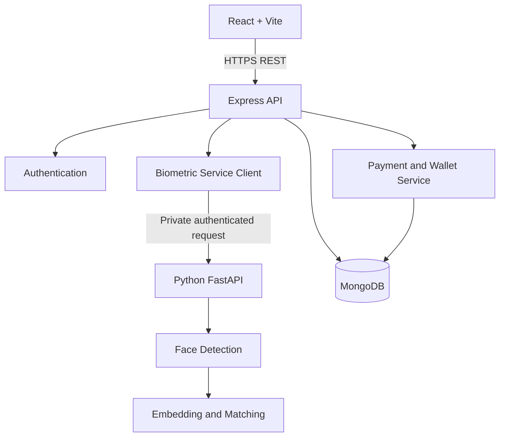
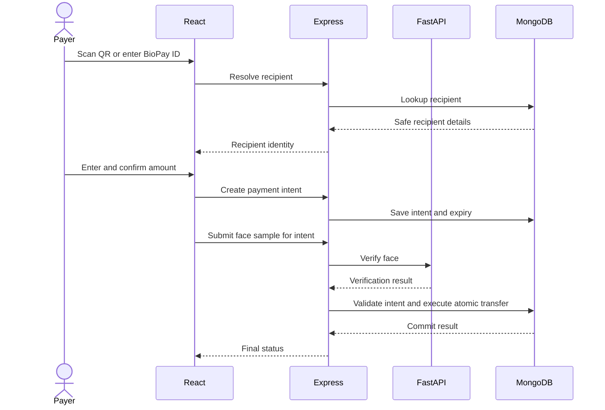
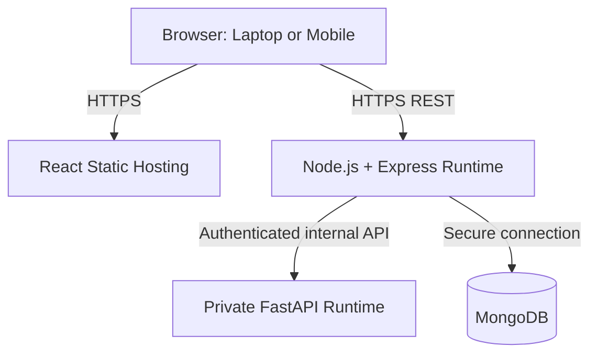

# BioPay — System Architecture

## 1. Overview
React communicates with Express. Express coordinates sessions, business rules, MongoDB, and a private FastAPI biometric service. Python performs biometric computation only. Express owns payment authorization and transfer execution.

## 2. Components
- React + Vite: signup, login, wallet, camera, QR, BioPay ID, confirmation, receipts, history.
- Express: authentication, validation, recipient resolution, payment intents, authorization, transfers, audit events.
- FastAPI: face detection/alignment, embedding generation, comparison.
- MongoDB: users, wallets, templates, intents, transactions, audit logs.
- Postman and automated tests: API and integration verification.
- Docker: repeatable packaging.

## 3. Component Diagram

## 4. Trust Boundaries
- Browser input is untrusted.
- Express validates input and authorization.
- Python is an internal service and cannot move funds.
- MongoDB credentials remain server-side and use least privilege.
- Biometric templates are sensitive and protected at rest.

## 5. Payment Sequence

## 6. Deployment Diagram

## 7. Rules
- Frontend never connects directly to MongoDB.
- Frontend never calls the internal biometric API directly.
- Python returns biometric results only.
- Never trust a frontend verification flag.
- Bind authorization to the exact intent and consume once.
- Use idempotency and atomic transfer logic.
- Keep secrets out of Git and source files.

## 8. Provisional Choices
FaceNet via `facenet-pytorch` is provisional pending licensing, compatibility, and performance checks. Hosting provider, QR library, camera library, and liveness approach are implementation decisions.
