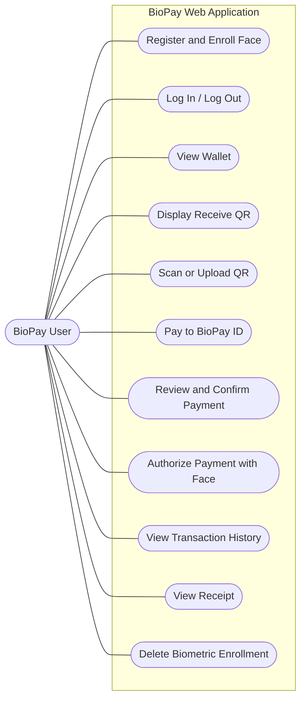
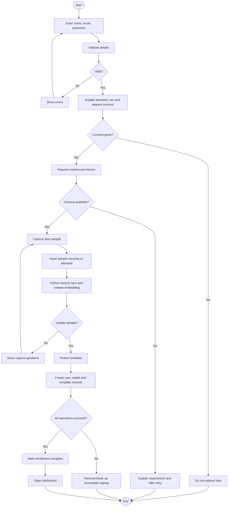
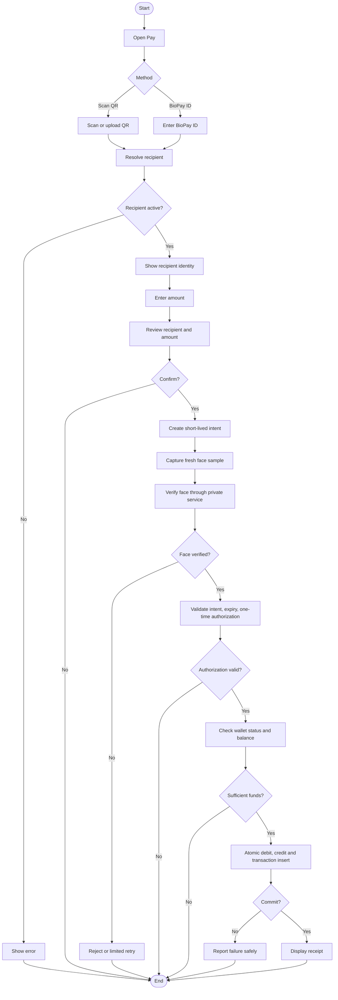
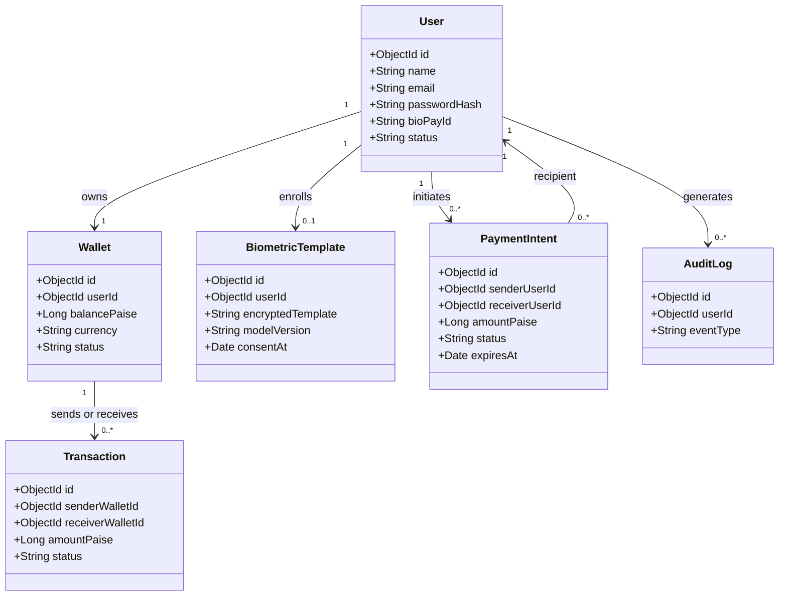

# BioPay — Workflow Design and UML

## 1. Use Case Diagram

## 2. Signup and Face Enrollment

Signup spans multiple components; use recoverable state and idempotent retries. A database transaction cannot roll back a separate service.

## 3. Payment Activity

## 4. Receive QR
1. Receiver opens Receive Money.
2. Frontend requests the current user's QR payload.
3. Backend returns a recipient identifier.
4. Frontend renders the QR.
5. Payer scans or uploads the image.
6. Backend validates the payload and resolves recipient.
7. Payer confirms recipient before entering amount.

QR identifies the recipient; it does not authorize payment.

## 5. Class Diagram

## 6. Payment Intent States
Successful path: `CREATED → PENDING_VERIFICATION → VERIFIED → PROCESSING → SUCCEEDED`.
Exception states: `FAILED`, `REJECTED`, `EXPIRED`. Enforce valid server-side transitions.

## 7. Failure Handling
- Invalid QR/ID: reject lookup.
- Invalid amount or inactive wallet: reject before transfer.
- Face mismatch: reject authorization; limit retries.
- Expired intent: require a new intent.
- Insufficient balance: neither wallet changes.
- Database failure: no success receipt.
- Duplicate confirmation: never transfer twice.
- Biometric service outage: fail closed for face-dependent payments.
